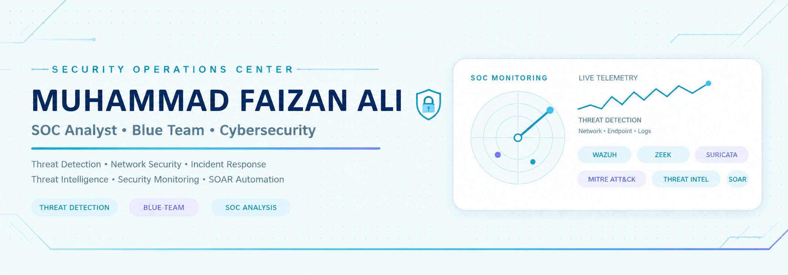

<p align="center">
  
</p>

<p align="center">
🎓 <b>BS Cyber Security Student</b> • 🛡️ <b>Ethical Hacking Enthusiast</b> • 🌐 <b>Network Security Learner</b> • 🔎 <b>Future Security Analyst</b>
</p>


---

# 🧠 About Me

I'm a **BS Cyber Security student at HITEC University Taxila, Pakistan**, with a strong interest in **information security, ethical hacking, network security, threat analysis, and SOC operations**.

I enjoy learning through hands-on labs and building practical security projects that help me understand how systems, networks, and security controls work in real-world environments.

My current focus is developing practical skills in **security monitoring, threat detection, network analysis, digital forensics, vulnerability assessment, and security automation**.

```text
Cyber Security
      │
      ├── Ethical Hacking
      ├── Network Security
      ├── SOC Operations
      ├── Threat Intelligence
      ├── Digital Forensics
      ├── Security Monitoring
      └── Security Automation
```

---

# 🔐 Cybersecurity Focus

### 🛡️ Security Operations

* Security monitoring and alert analysis * SIEM concepts and SOC workflows * Wazuh security monitoring * Security event investigation * Incident analysis

### 🌐 Network Security

* Network traffic analysis * Nmap scanning and enumeration * Wireshark packet analysis * Zeek Network Security Monitoring
* Suricata IDS/IPS * Network reconnaissance

### 🔎 Threat Intelligence

* IOC analysis * Malware intelligence * Hash investigation * MITRE ATT&CK mapping * VirusTotal analysis * AlienVault OTX

### ⚙️ Security Automation

* Wazuh alert automation * n8n workflows * Webhook-based security integrations
* Python security scripting * SOAR concepts* AI-assisted security alert analysis

### 🐧 Linux & Security Labs

* Kali Linux * Ubuntu * Linux administration * VirtualBox / VMware * Security lab environments
* TryHackMe & Hack The Box

---

# 🚀 Current Learning

I'm continuously developing my skills in:

* 🔐 Ethical Hacking * 🌐 Network Security * 🛡️ SOC Operations
* 🔎 Threat Intelligence * 🧬 Digital Forensics * 📊 Security Monitoring
* 🤖 Security Automation * 🧠 MITRE ATT&CK * 🐍 Python for Cybersecurity
* 🧩 Data Structures & Algorithms * 🌍 Network Administration

---

# 🧪 Cybersecurity Projects

> A collection of cybersecurity, software development, network security, and machine learning projects, documenting practical implementation, tools, and technical learning.

### 🤖 [Wazuh + n8n + AI Security Automation](https://github.com/muhammadfaizanali102/wazuh-n8n-Ai-security-Automation)

Security automation project focused on integrating Wazuh security monitoring with n8n workflows and AI-assisted alert analysis. Explores webhook-based alert processing, workflow automation, and the development of a more efficient security operations workflow.

[](https://wazuh.com/)
[](https://n8n.io/)
[](https://www.docker.com/)
[](https://github.com/muhammadfaizanali102/wazuh-n8n-Ai-security-Automation)

### 📦 [Inventory Management System](https://github.com/muhammadfaizanali102/Inventory-Management-System)

A web-based inventory management application designed to organize product records and support inventory-related operations. Developed using PHP, MySQL, and Bootstrap, with a dashboard interface for managing inventory data and related records.

[](https://www.php.net/)
[](https://www.mysql.com/)
[](https://getbootstrap.com/)
[](https://www.apachefriends.org/)

### 🏏 [Cricket Match Outcome Prediction](https://github.com/muhammadfaizanali102/Cricket-Match-Outcome-Prediction)

A machine learning project focused on analyzing cricket match data and predicting match outcomes. This project explores data preparation, feature analysis, and predictive modeling to investigate patterns that may influence the result of a cricket match.

[](https://www.python.org/)
[](https://github.com/muhammadfaizanali102/Cricket-Match-Outcome-Prediction)
[](https://jupyter.org/)

### 🔐 [SecureHash — Password Hashing & Verification](https://github.com/muhammadfaizanali102/Secure-Hashing)

A password security application focused on secure password hashing and verification. The project explores modern password protection techniques, authentication security, and supporting features for strengthening credential management.

[](https://www.python.org/)
[](https://github.com/P-H-C/phc-winner-argon2)
[](https://www.sqlite.org/)
[](https://github.com/muhammadfaizanali102/Secure-Hashing)

### 🏥 [Secure Healthcare Network](https://github.com/muhammadfaizanali102/Secure-HealthCare-Netthat)

A healthcare network design project focused on secure communication, network segmentation, and protecting sensitive organizational resources. The network design explores enterprise networking concepts such as VLANs, routing, access control, and network availability using Cisco Packet Tracer.

[](https://www.cisco.com/)
[](https://www.netacad.com/)
[](https://github.com/muhammadfaizanali102/Secure-HealthCare-Netthat)
[](https://github.com/muhammadfaizanali102/Secure-HealthCare-Netthat)


# 🧰 Security Tools

<p align="center">


</p>

<p align="center">


</p>

<p align="center">


</p>

---

# 💻 Programming & Development

<p align="center">


</p>

### Languages

```text
Python       ████████████████████
C++          ███████████████
Java         █████████████
PHP          ████████████
JavaScript   ███████████
SQL          ███████████
```
# 📊 GitHub Analytics

<p align="center">


</p>

---

# 🔥 GitHub Streak

<p align="center">


</p>

---

# 🌐 Connect With Me

<p align="center">

<a href="mailto:muhammadfaizanali102@gmail.com">

</a>

<a href="https://github.com/muhammadfaizanali102">

</a>

</p>

---

# 🧠 Security Mindset

<p align="center">

<b>Learn → Build → Analyze → Secure → Improve</b>

</p>

Cybersecurity is a continuous learning process. I believe that practical experimentation, understanding how systems work, and consistently improving defensive skills are essential for becoming a better security professional.

---

<h3 align="center">

🛡️ Thanks for visiting my profile!

</h3>

<p align="center">

⭐ Explore my repositories • 🔎 Follow my cybersecurity journey • 🚀 Let's build and learn

<p align="center">
  
</p>

<p align="center">
  <b>Cyber Security Student | SOC Analyst | Blue Team | Network Security</b>
</p>
